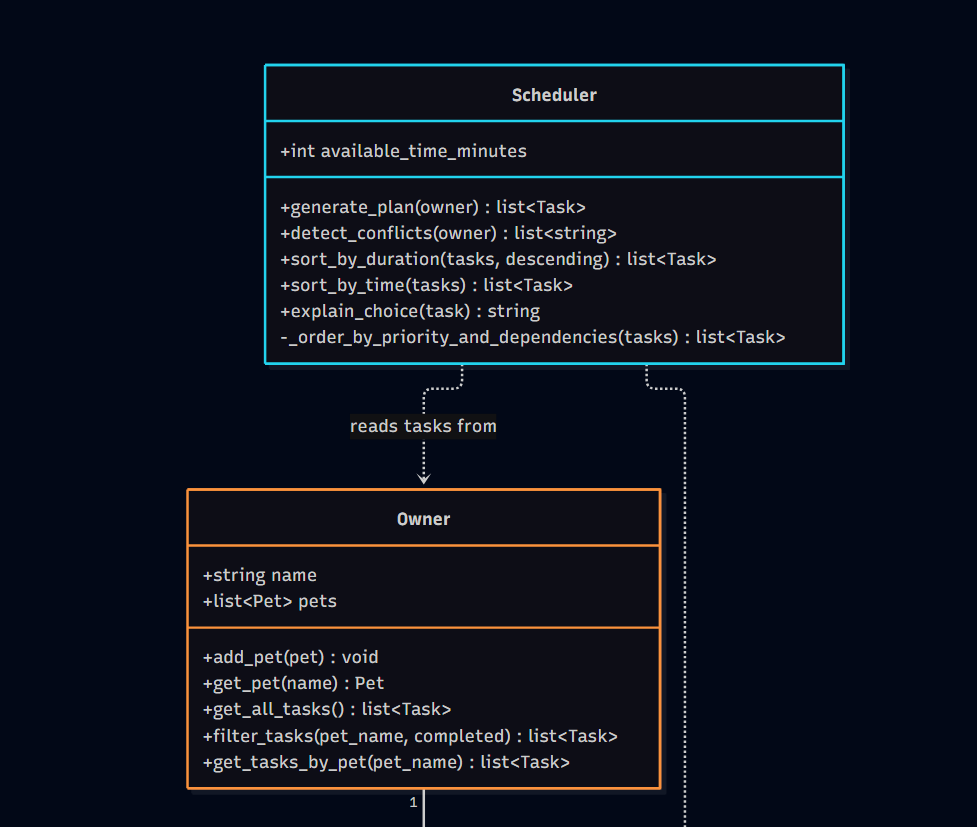
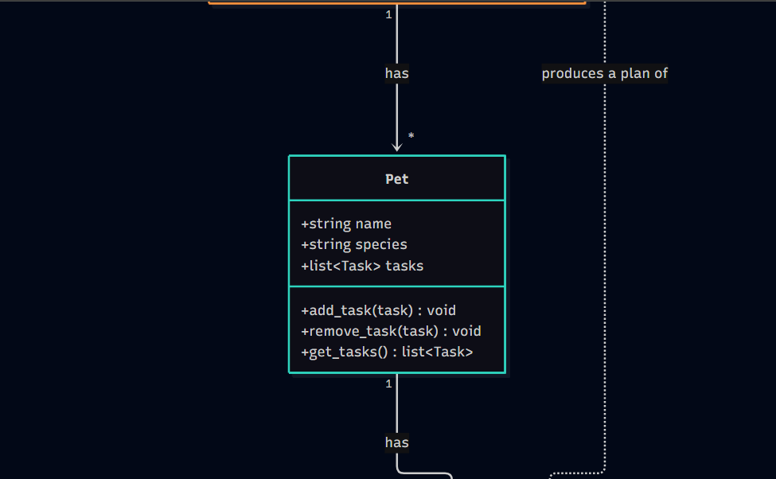
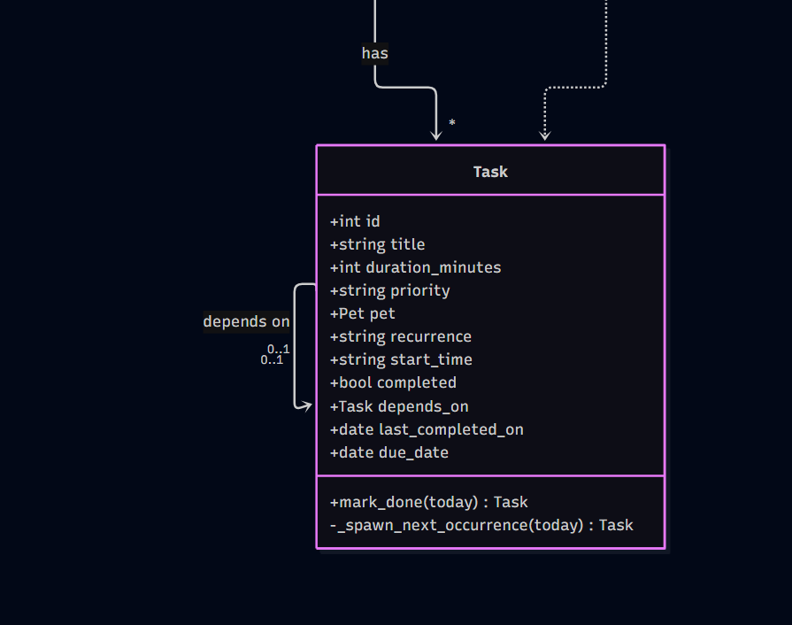
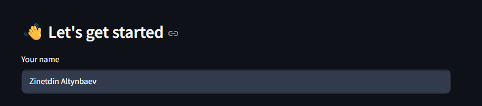
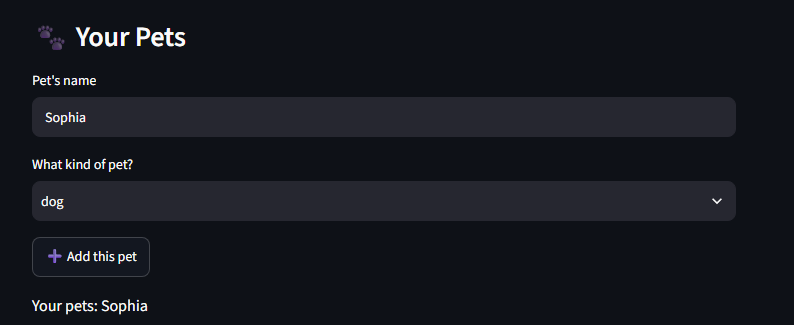
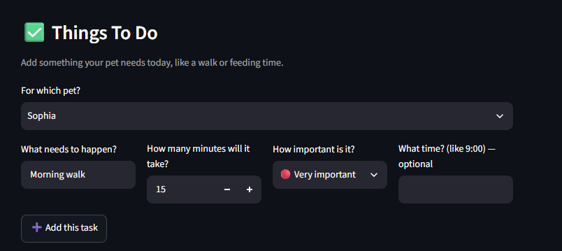
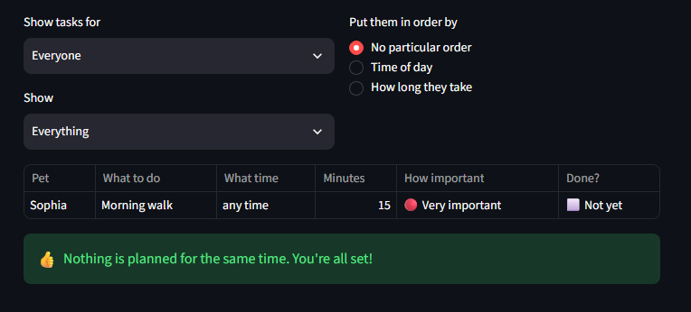
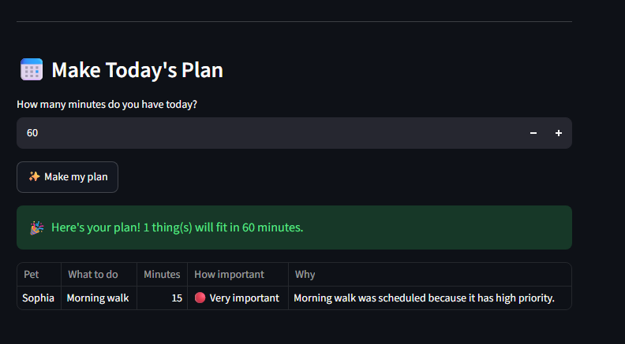

# PawPal+ (Module 2 Project)

You are building **PawPal+**, a Streamlit app that helps a pet owner plan care tasks for their pet.

## Scenario

A busy pet owner needs help staying consistent with pet care. They want an assistant that can:

- Track pet care tasks (walks, feeding, meds, enrichment, grooming, etc.)
- Consider constraints (time available, priority, owner preferences)
- Produce a daily plan and explain why it chose that plan

Your job is to design the system first (UML), then implement the logic in Python, then connect it to the Streamlit UI.

## What you will build

Your final app should:

- Let a user enter basic owner + pet info
- Let a user add/edit tasks (duration + priority at minimum)
- Generate a daily schedule/plan based on constraints and priorities
- Display the plan clearly (and ideally explain the reasoning)
- Include tests for the most important scheduling behaviors

## Implementation Summary

The backend logic lives in `pawpal_system.py`, with four classes:

- **`Task`** — a single care activity (title, duration, priority, optional recurrence, completed flag, and an auto-generated `id`). A `Task` can also point to another task via `depends_on`, so one task can be required to happen before another (e.g. a pee break before a meal).
- **`Pet`** — holds a pet's basic info and its list of `Task`s. `add_task()`/`remove_task()` keep the task's back-link to its pet in sync.
- **`Owner`** — holds a list of `Pet`s and exposes `get_all_tasks()`, which flattens every pet's tasks into one list. This is what lets the system support multiple pets.
- **`Scheduler`** — the planning logic. `generate_plan(owner)` pulls tasks from `owner.get_all_tasks()` (never from a single pet directly), orders them by priority while respecting any `depends_on` constraints, then greedily fits as many as it can into `available_time_minutes`. `explain_choice(task)` gives a one-line reason for each task.

`Task` and `Pet` are implemented as Python dataclasses since they're mostly data; `Owner` and `Scheduler` are regular classes since they do more active work. `main.py` is a small terminal script that wires these classes together and prints the resulting schedule — it's the easiest way to see the logic run without the Streamlit UI.

### UML diagram

The full class diagram source is in [`diagrams/uml_final.mmd`](diagrams/uml_final.mmd). Rendered view:





## ✨ Features

- **Priority + dependency-aware scheduling** — fits tasks into a time budget, highest priority first, while never scheduling a task before whatever it `depends_on` (e.g. a pee break before a meal). (`Scheduler.generate_plan()`)
- **Multi-pet support** — tasks are gathered across every pet an owner has, not just one. (`Owner.get_all_tasks()`)
- **Sorting by time** — puts tasks in chronological order by `start_time`, with untimed tasks pushed to the end. (`Scheduler.sort_by_time()`)
- **Sorting by duration** — orders tasks from shortest to longest (or reverse). (`Scheduler.sort_by_duration()`)
- **Filtering by pet and/or status** — narrow the task list to one pet, to only pending/completed tasks, or both at once. (`Owner.filter_tasks()`)
- **Conflict warnings** — flags when two tasks (same pet or different pets) are booked at the exact same time, without crashing the program. (`Scheduler.detect_conflicts()`)
- **Daily/weekly recurrence** — completing a recurring task automatically creates its next occurrence, due `today + 1` or `today + 7` days. (`Task.mark_done()`)

## Getting started

### Setup

```bash
python -m venv .venv
source .venv/bin/activate  # Windows: .venv\Scripts\activate
pip install -r requirements.txt
```

### Suggested workflow

1. Read the scenario carefully and identify requirements and edge cases.
2. Draft a UML diagram (classes, attributes, methods, relationships).
3. Convert UML into Python class stubs (no logic yet).
4. Implement scheduling logic in small increments.
5. Add tests to verify key behaviors.
6. Connect your logic to the Streamlit UI in `app.py`.
7. Refine UML so it matches what you actually built.

## 🖥️ Sample Output

Terminal output from running `python main.py`:

```
Today's Schedule
------------------------------
[Sohpia] Pee break - 5 min (priority: high)
[Milo] Feeding - 10 min (priority: high)
[Sohpia] Morning walk - 30 min (priority: medium)
```

Note the ordering rules baked into this routine: pee break always happens right before a meal, and the snack comes right after the evening walk but dinner is deliberately later rather than back-to-back.

## 🧪 Testing PawPal+

```bash
# Run the full test suite:
python -m pytest

# Run with coverage:
python -m pytest --cov
```

`tests/test_pawpal.py` covers 5 core behaviors: marking a task done, adding a task to a pet, sorting tasks chronologically by `start_time`, a daily task spawning its next occurrence via `mark_done()`, and the scheduler flagging two tasks booked at the same time.

Sample test output (`python -m pytest`):

```
============================= test session starts =============================
platform win32 -- Python 3.12.10, pytest-9.0.3, pluggy-1.6.0
rootdir: C:\Users\Orange\Documents\GitHub\ai110-module2show-pawpal-starter
plugins: anyio-4.13.0
collected 5 items

tests\test_pawpal.py .....                                               [100%]

============================== 5 passed in 0.01s ==============================
```

## 📐 Smarter Scheduling

|       Feature     |                        Method(s)                           |                                                           Notes                             |
|---------          |------------------------------------------------------------|---------------------------------------------------------------------------------------------|
| Task sorting      | `Scheduler.sort_by_time()`, `Scheduler.sort_by_duration()` | Sorts by `start_time` ("HH:MM", untimed tasks last) or by `duration_minutes`. Separate from `generate_plan()`'s own priority/dependency ordering. |
| Filtering         | `Owner.filter_tasks(pet_name=None, completed=None)`        | Narrows tasks by pet name and/or completion status; either filter is optional and they can be combined. |
| Conflict handling |              `Scheduler.detect_conflicts(owner)`           | Groups all of an owner's timed tasks by `start_time` across every pet; any time shared by 2+ tasks returns a warning message (never raises). Tradeoff: checks for an exact `start_time` match, not true overlapping durations — see `reflection.md` section 2b. |
| Recurring tasks   |        `Task.mark_done()`, `Task._spawn_next_occurrence()` | Completing a `"daily"`/`"weekly"` task spawns a brand-new `Task` instance due `today + timedelta(days=1 or 7)`, attached to the same pet. The original instance stays completed as history. |

## 📸 Demo Walkthrough

### Main features and what you can do

- **Add pets** — enter a name and species, then add as many pets as you own.
- **Add tasks** — for any pet, add a task with a title, duration, importance (priority), and an optional fixed time ("09:00").
- **Sort tasks** — view tasks in their default order, by time of day, or by how long they take.
- **Filter tasks** — show tasks for one pet only, and/or only the ones still pending or already done.
- **See conflict warnings** — if two tasks (same pet or different pets) are booked at the same time, the app warns you instead of silently double-booking.
- **Generate a schedule** — say how many minutes you have, and the app builds an ordered plan that fits, explaining why each task was chosen.

### Example workflow

1. Run `streamlit run app.py` and open the app in your browser.
2. Add a pet (e.g. "Mochi," a dog).
3. Add a task for Mochi — e.g. "Morning walk," 20 minutes, high importance.
4. Add a second task at the same time as an existing one, to see the conflict warning appear.
5. Enter how much time you have today and click "Make my plan" to see today's schedule.

### Key Scheduler behaviors shown

- **Sorting**: tasks added out of order (afternoon, then morning, then evening) still come back in correct chronological order when sorted by time.
- **Conflict warnings**: two tasks booked for the same clock time — even across two different pets — get flagged with a plain-language warning instead of crashing the app.
- **Priority + dependency scheduling**: a tight time budget proves lower-priority tasks get dropped, and a "pee break before breakfast" dependency is respected even when both tasks share the same priority.
- **Recurrence**: completing a daily/weekly task spawns a brand-new task due the next day/week, rather than reusing the same completed one.

### Sample CLI output (`python main.py`)

```
Today's Schedule
------------------------------
[Sohpia] Pee break - 5 min (priority: high)
[Sohpia] Breakfast - 10 min (priority: high)

Skipped (did not fit in the available time):
  [Sohpia] Morning walk
  [Milo] Feeding

After marking 'Pee break' done, the next plan is:
Today's Schedule
------------------------------
[Sohpia] Breakfast - 10 min (priority: high)
[Milo] Feeding - 10 min (priority: high)

Skipped (did not fit in the available time):
  [Sohpia] Morning walk

--- Sorted by time ---
09:15 - Vet checkup
14:30 - Grooming
18:00 - Evening walk
None - Pee break
None - Breakfast
None - Morning walk

--- Sorted by duration ---
5 min - Pee break
10 min - Breakfast
15 min - Grooming
20 min - Vet checkup
30 min - Morning walk
30 min - Evening walk

--- Filtered: Sohpia's tasks only ---
[Sohpia] Pee break
[Sohpia] Breakfast
[Sohpia] Morning walk
[Sohpia] Grooming
[Sohpia] Vet checkup
[Sohpia] Evening walk

--- Filtered: completed tasks only ---
[Sohpia] Pee break

--- Conflict check ---
WARNING: Conflict at 09:15: Vet checkup (Sohpia), Milo's grooming (Milo)
```

**Screenshots** *(optional, for human reviewers)*: the same workflow above, run in the actual Streamlit app.

| Step | Screenshot |
|---|---|
| 1. Enter your name |  |
| 2. Add a pet |  |
| 3. Add a task |  |
| 4. View the task list (no conflicts) |  |
| 5. Generate today's plan |  |

